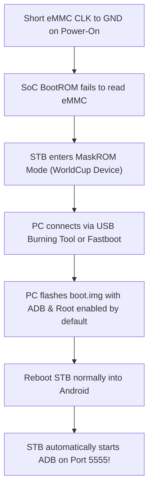
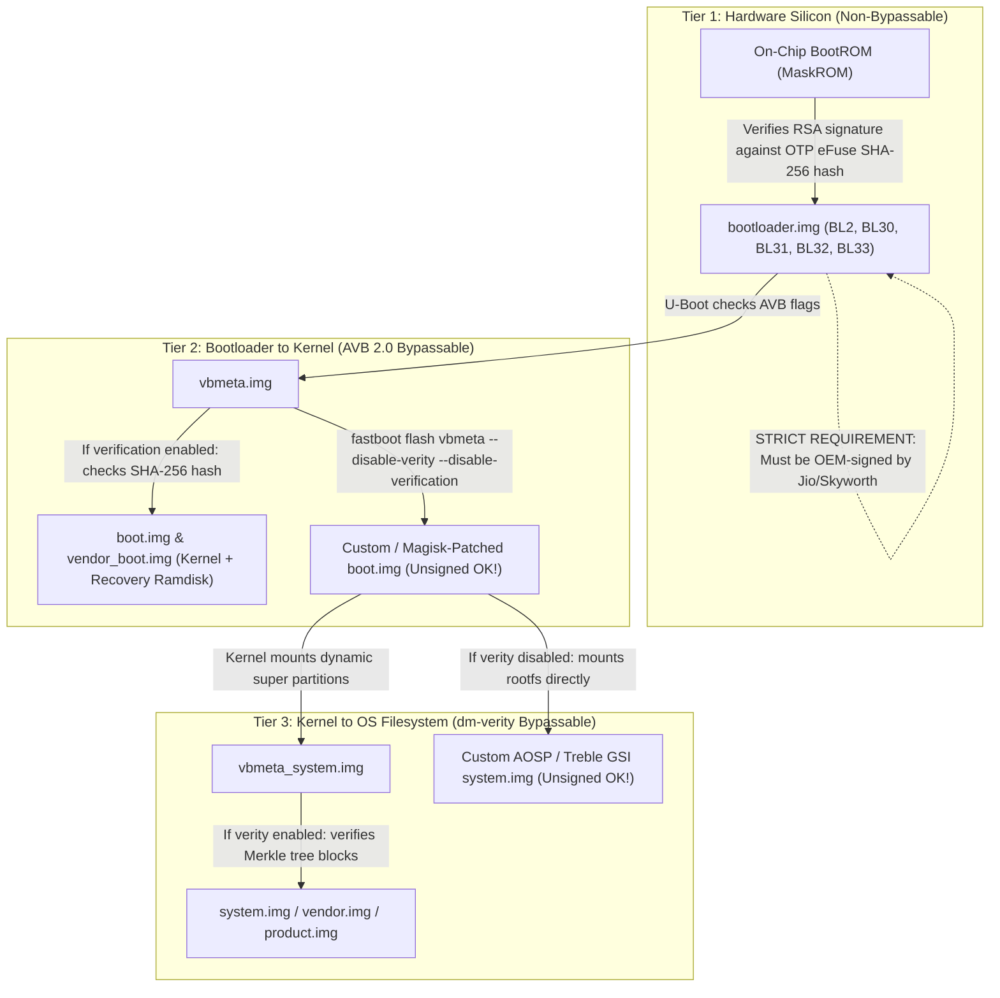

# Amlogic S905X4 MaskROM / WorldCup Flashing & Security Vector Analysis

Comprehensive reverse engineering documentation of software bypass failures and the exact hardware procedure for forcing **Amlogic MaskROM / USB Burning Mode (WorldCup Device)** on the **Jio 4K STB (Model JMSB200A / Skyworth platform `5800-2AHP44T` / Amlogic S905X4)**.

---

## 1. 🔍 Deep Investigation: Why Software & Network Vectors Failed

> **Activation procedure:** The step-by-step remote sequence (OK 10× within 4s → About Details → Android Setting → Developer Options → ADB) is documented as a working procedure in [`ROOT_ADB_CUSTOM_ROM_GUIDE.md` §1 Method 1](ROOT_ADB_CUSTOM_ROM_GUIDE.md#1--enabling-adb-debugging). This section analyzes *why* that sequence fails in production builds.

### 1.1 The 10-Times Remote Sequence Failure
Reverse engineering of `com.rjil.jiostbsetting.fragments.about.DetailsFragment` inside `JioSettings.apk` reveals the exact implementation of the technician trigger:

```java
// DetailsFragment.java - decompiled from JioSettings.apk
@Override // com.rjil.jiostbsetting.MainActivity.KeyEventListener
public boolean dispatchKeyEvent(KeyEvent event) {
    StringBuilder sb = new StringBuilder("event=");
    Intrinsics.checkNotNull(event);
    LoggerKt.logger(sb.append(event.getAction()).toString());
    this.keyCodeTime = true;
    try {
        if (event.getAction() == 1) { // ACTION_UP only
            LoggerKt.logger("Up KeyCode = " + event.getKeyCode());
            if (event.getKeyCode() != 19 && event.getKeyCode() != 20) { // Ignores DPAD_UP (19) & DPAD_DOWN (20)
                this.keyCombination += event.getKeyCode();
                LoggerKt.logger("KeyCombination = " + this.keyCombination);
            }
        }
        LoggerKt.logger("KeyCombination : " + this.keyCombination);
        if (this.keyCodeTime && Intrinsics.areEqual(this.keyCombination, ConstantKt.SHOW_HIDDEN_OPTION_CODE)) {
            LoggerKt.logger("activate show hidden options");
            MainActivity.INSTANCE.setShowHiddenOptions(true);
        }
    } catch (Exception e) {
        e.printStackTrace();
    }
    new Handler(Looper.getMainLooper()).postDelayed(new Runnable() {
        @Override
        public final void run() {
            DetailsFragment.this.keyCodeTime = false;
            DetailsFragment.this.keyCombination = "";
        }
    }, 4000L);
    return false;
}
```

In `ConstantKt.java`:
```java
public static final String SHOW_HIDDEN_OPTION_CODE = "23232323232323232323";
```

#### Why it fails in production user builds:
1. **Keycode Divergence (`23` vs `66` / `160`)**:
   * `SHOW_HIDDEN_OPTION_CODE` is hardcoded as `"23232323232323232323"` (10× `KEYCODE_DPAD_CENTER`, keycode `23`).
   * Production Bluetooth remotes (like the Jio Voice Remote) or USB keyboards send `KEYCODE_ENTER` (keycode `66`) or `KEYCODE_NUMPAD_ENTER` (keycode `160`) on the OK button.
   * When keycode 66 is sent, the accumulator builds `"66666666666666666666"`, which fails string equality against `"23232323232323232323"`.
2. **Strict 4-Second Leaky Accumulator**:
   * The 4000ms timer starts immediately on the *first* key event and is **not refreshed** per click. If you press OK 9 times and the 10th press lands at 4.05 seconds, the handler fires, clears `keyCombination = ""`, and sets `keyCodeTime = false`.
3. **Menu Lifecycle & Reset on Destroy**:
   * In `MainActivity.java`:
     ```java
     @Override
     protected void onDestroy() {
         super.onDestroy();
         isShowHiddenOptions = false;
     }
     ```
   * If the fragment transaction pops and recreates `MainActivity`, the boolean flag reverts to `false`.
4. **User Build Stripping (`ro.build.type == "user"`)**:
   * In production release `25.1.9` (`Skyworth/JMSB200A/ohm:11/25.1.9/1:user/release-keys`), carrier security policies suppress hidden option rendering in `MenuUtilsKt.java`.

---

### 1.2 Factory Setup USB APK Path: The Signer Check
The hidden **Factory Setup** item is a JioSettings-managed USB installer, not Android's general "open this APK" installer. Its code applies a signer check before it asks Android's `PackageInstaller` to install anything. This is why a normal APK copied to USB is skipped even when the APK itself is valid.

The analysis below is from the decompiled `JioSettings.apk` in `ota_packages/extracted/apks/jio_system_priv_app/JioSettings.apk` (`com.rjil.jiostbsetting`, manifest version `15.1.5`). The decoded Java is reconstructed by JADX; the control flow and strings below are present in the APK.

#### 1. Entry point and USB copy
Clicking the Factory Setup row calls `openAndTestFactorySetup()`. It passes the mounted USB volume path and the directory name `factory_apps` to `copyFileFromUSBtoExternal()`, then runs `checkFactoryApps()`.

The copy helper reads **direct child files** of `<USB volume>/factory_apps`; it copies files ending in `.apk` and skips AppleDouble files whose names start with `._`. It does not recursively search subdirectories. When shared external storage is mounted, the destination is `${Environment.getExternalStorageDirectory()}/Factory_app` (commonly `/storage/emulated/0/Factory_app`); otherwise it falls back to the app's external-files directory.

#### 2. APK metadata and signer gate
For each file in the destination directory, `checkFactoryApps()` first asks Android to parse its package name. If parsing fails, the file is skipped. It then compares the candidate APK's JAR signer certificate to the signer certificate of JioSettings itself. The central branch is:

```java
String settingCertificate = getSettingCertificate(context);
String packageName = getPackageNameFromApk(context, apk.getPath());

if (packageName != null) {
    boolean signerMatches = isAppSignedWithCertificate(settingCertificate, apk);
    if (signerMatches) {
        if (!isAppPackageInstalled(context, packageName)) {
            installApk(context, apk);
        } else {
            // Already installed: reported as installed; installApk is not called.
        }
    } else {
        LoggerKt.logger("checkFactoryApps: apk is not certified to install");
    }
}
```

`getSettingCertificate()` reads JioSettings' own signing certificate with `PackageManager.getPackageInfo()` (`GET_SIGNING_CERTIFICATES` on Android 9/API 28 and later; `GET_SIGNATURES` on older versions). It takes the first APK content signer. `getCertificateSHA256()` computes SHA-256 over the certificate's encoded bytes and Base64-encodes the digest without line breaks. This is a **certificate fingerprint**, not a hash of the APK file.

`isAppSignedWithCertificate()` opens the candidate with `java.util.jar.JarFile`. For each non-directory, non-`META-INF/` entry, it reads the entry fully so the JAR signature is checked, obtains the entry's signer certificates, and compares each certificate's SHA-256 fingerprint with JioSettings' expected fingerprint. No matching certificate, an unparseable/unsigned APK, or an exception returns `false`; that APK never reaches `installApk()`.

The checked-in JioSettings APK verifies with `apksigner`; its reported certificate SHA-256 is `3594dd51b8eba15fb5be4e229c5c1a061c6c1e220b421339e2f37e30d37b0a88` (hex form). JioSettings' code compares the equivalent digest in Base64 form. Since this check reads JAR entry certificates, the code does not establish that a v2/v3-only APK with no usable JAR signer will pass this custom gate; Android performs its own APK validation later as well.

#### 3. Install operation after approval
Only a matching signer reaches `installApk()`. That method uses `PackageManager.getPackageInstaller()`, creates a `SessionParams(1)` full-install session, writes the APK bytes to the session, calls `fsync()`, and commits with an `InstallReceiver` callback. The receiver logs success or the PackageInstaller status message. This is a direct `PackageInstaller` session, rather than a launch of the user-facing package-installer screen.

An already-installed package is not reinstalled by this Factory Setup loop: the code logs that it is already installed and skips `installApk()`. A package with a different signer is rejected before Android's installer is called. This custom filter is the decisive difference for the USB route.

#### 4. Why Jio Store installs follow a different route
The checked-in `JioStore.apk` (`com.jio.store`, manifest version `1.5.8.7`) declares `INSTALL_PACKAGES`, `REQUEST_INSTALL_PACKAGES`, `DELETE_PACKAGES`, and `REQUEST_DELETE_PACKAGES`. The JioSettings manifest also declares `INSTALL_PACKAGES`; therefore, the Factory Setup restriction is not simply a limitation of Android's install API. It is a policy check in JioSettings' own USB workflow, which runs before that API is called.

The decompiled Jio Store install helper also uses `PackageInstaller` sessions. In simplified form, it takes a downloaded APK path and the expected package name, creates a full-install session, writes the APK into it, and commits the session:

```java
PackageInstaller installer = context.getPackageManager().getPackageInstaller();
SessionParams params = new SessionParams(MODE_FULL_INSTALL);
params.setAppPackageName(packageName);
int sessionId = installer.createSession(params);
Session session = installer.openSession(sessionId);
// Copy downloaded APK bytes into the session and fsync.
session.commit(installCompleteCallback);
```

So the distinction is **which preinstalled component requests the install and what checks that component applies**. Factory Setup requires a candidate signer to match JioSettings' signer. Jio Store's internal install path submits a selected/downloaded package through the store's PackageInstaller session; it does not call the Factory Setup signer-check function. Android still validates the APK and its package-signing/update rules. The catalog row is evidence of the store's declared permissions, not proof by itself that every permission is granted in every firmware build; the matching live permission grant/allowlist is not included in this APK-only extraction.

This does not mean Factory Setup checks whether an APK came from Jio Store. It checks the signer certificate. In principle, any APK signed with the expected JioSettings signer could pass that check, while a Jio Store download signed by a different publisher would not pass it if copied into `factory_apps`.

#### 5. Scope and evidence limits
* This code proves the policy for the **Factory Setup USB path**. It does not prove that Android's ordinary "Install unknown apps" setting or every file-manager/browser install path is globally disabled; those are separate flows.
* The guide documents `adb install` as another route when ADB is enabled and authorized: [`ROOT_ADB_CUSTOM_ROM_GUIDE.md`](ROOT_ADB_CUSTOM_ROM_GUIDE.md).
* The checked-in JioStore manifest and decompiled install helper show requested permissions and install-session behavior. However, `apksigner verify --print-certs` fails on the current `JioStore.apk` artifact because its JAR metadata indicates a v2 signature but the v2 signature block is absent. Treat its manifest/code as static-analysis evidence, not proof that this exact file is an intact, installable production APK or that its permissions were granted at runtime.
* The practical effect is an OEM-controlled factory provisioning path. That it is intended to restrict unapproved apps for security, compatibility, or support reasons is a reasonable inference; the implementation does not state the product rationale.

---

### 1.3 Why Captive Portal Browser Drops `intent:` Schemes
When connecting to a captive portal Wi-Fi network, Android launches `CaptivePortalLoginActivity` (`com.google.android.networkstack`):

1. **AOSP `WebViewClient` URL Whitelisting**:
   ```java
   @Override
   public boolean shouldOverrideUrlLoading(WebView view, String url) {
       if (url.startsWith("http://") || url.startsWith("https://")) {
           return false; // Render captive page inside WebView
       }
       return true; // Returns true: CONSUMES AND SILENTLY DROPS THE INTENT
   }
   ```
   * Returning `true` informs Chromium that the application handled the URL. The request is consumed internally and never forwarded to the Android `ActivityManager`.
2. **Android 11 (API 30) Package Visibility Restrictions (`<queries>`)**:
   * Apps targeting Android 11 cannot resolve or invoke external package components unless explicitly declared under `<queries>` in `AndroidManifest.xml`.
   * `NetworkStack` has no `<queries>` entry for `com.android.tv.settings`, making cross-package intent launches structurally impossible from the captive browser sandbox.

---

### 1.4 Why Stock Recovery Has No "Apply update from ADB" or "Fastboot"
* Carrier-locked Android 11 TV builds replace standard AOSP recovery menus with a stripped recovery UI.
* Only **"Reboot system now"** and **"Wipe data/factory reset"** are exposed.
* `Apply update from ADB` (ADB sideload mode) and `Enter fastboot` (`fastbootd`) are intentionally omitted to prevent sideloading unsigned or test-signed packages.

---

### 1.5 Why USB Boot (CoreELEC / Armbian) Does Not Trigger
* On commercial Amlogic devices, stock U-Boot prioritizes internal eMMC partitions (`soc/fe08c000.mmc`).
* Holding `SK01` (Reset) merely triggers U-Boot's internal `run recovery` command to load `recovery.img` from eMMC.
* U-Boot does **not** evaluate external USB drives (`run usb_boot`) unless:
  1. An active Android system issues `adb reboot update` (which sets the BCB/U-Boot flag `upgrade_step=2`), OR
  2. The SoC is placed into MaskROM mode to rewrite or override boot execution.

---

### 1.6 Why Hardware UART Appeared Dead
> **Canonical pinout & wiring:** The complete `J7` header diagram, staggered-pad layout, USB-to-TTL wiring instructions, and photographic cross-reference live in [`TEARDOWN.md` §6.1](TEARDOWN.md#61-uart-serial-console-j7). This section only summarizes why a live UART shell is not achievable on the production `user` build.

1. **Baud Rate Trap (921,600 vs 115,200)**:
   * The Amlogic S905X4 (SC2 family) bootloader runs at **`921600` baud (8N1)**.
   * Connecting at `115200` baud produces complete silence or unreadable garbage characters.
2. **Staggered Pinout (`J7`)**:
   * Header `J7` has 4 staggered pads:
     * Pad 1: `GND`
     * Pad 2: `RX` (SoC input, connect to adapter TX)
     * Pad 3: `TX` (SoC output, connect to adapter RX)
     * Pad 4: `3V3` (**DO NOT CONNECT**)
   * Connecting adapter RX to Pad 4 (3.3V rail) results in a flat high line with zero data.
3. **User Build Console Suppression**:
   * In the production user build (`buildvariant=user`, `ro.debuggable=0`), the kernel command line disables the interactive root shell console (`/system/bin/sh`) under SELinux. Even if boot logs stream over TX, the RX channel will not accept interactive terminal commands.

---

## 2. ⚡ Forcing Amlogic MaskROM Mode (WorldCup Device)

When all software, network, recovery, and UART vectors fail, the universal hardware recovery mechanism is **Amlogic MaskROM Mode**.

```
       Host PC (USB-A)
              │
              ▼  (USB-A to USB-A Male Cable)
     ┌─────────────────────────────────────────────────────────┐
     │ Jio STB Rear Panel                                      │
     │ [DC In]    [USB 3.0 Blue]   [USB 2.0 Black]   [RJ45]    │
     └───────────────────────────────────▲─────────────────────┘
                                         │  (OTG / Flashing Port)
                                         │
               ┌─────────────────────────┴─────────────┐
               │ SoC (Amlogic S905X4 under Heatsink)   │
               └──────────────┬────────────────────────┘
                              │
                    CLK / DAT0 Line Grounded
                              │
               ┌──────────────▼────────────────────────┐
               │ Samsung eMMC 5.1 (11UF1)              │
               │ Short CLK / DAT0 to GND on Power-On   │
               └───────────────────────────────────────┘
```

### 2.1 Hardware BootROM Execution Sequence
1. Upon power connection, the immutable on-chip **BootROM (Mask ROM)** inside the S905X4 initializes first.
2. The BootROM queries storage media in a strict fallback order:
   * **Stage 1**: SPI NOR/NAND Flash (unpopulated on board)
   * **Stage 2**: **eMMC Flash (`11UF1`)**
   * **Stage 3**: SD Card / MMC (unpopulated on board)
   * **Stage 4**: **USB DFU / MaskROM Flashing Server (`1b8e:05af` / `1b8e:c003`)**
3. When eMMC is accessible, BootROM reads the Stage 2 bootloader (`BL2`) from eMMC and transfers execution.
4. **The eMMC Pin Short Mechanism**:
   * Grounding the eMMC **Clock (`CLK`)** or **Data (`DAT0`)** line interrupts the initial `CMD0`/`CMD1` bus handshake.
   * The BootROM times out on eMMC initialization (~150 ms), concludes that external non-volatile storage is missing/corrupted, and drops into **Stage 4: USB MaskROM Mode**.

---

### 2.2 Board Pinout & Component Identification

Refer to the labeled visual guides generated directly from the board teardown:
* **High-Resolution Macro View**: [`img/EMMC_SHORT_POINTS_DETAILED.jpg`](img/EMMC_SHORT_POINTS_DETAILED.jpg) (Exact microscopic gold pads and resistor cluster)
* **Whole-Board Overview**: [`img/EMMC_SHORT_POINTS_OVERVIEW.jpg`](img/EMMC_SHORT_POINTS_OVERVIEW.jpg) (USB 2.0 port `JB03`, 12V DC input `JP01`, and eMMC zone layout)

| Component | Designator | Specification / Role |
| :--- | :--- | :--- |
| **SoC** | Under heatsink | Amlogic S905X4 Quad Cortex-A55 @ 2.0 GHz |
| **eMMC Flash** | `11UF1` | Samsung `KLMBG2JETD-B041` (32 GB eMMC 5.1, FBGA-153) |
| **Flashing USB Port** | `JB03` | **Black USB 2.0 Port** (*Do NOT use blue USB 3.0 `JB01`*) |
| **Ground Reference** | `GND` | Metal shield of `JB03`, Ethernet `JL01`, or PCB screw rings |
| **DC Power Jack** | `JP01` | 12V DC center-positive barrel input |

#### Shorting Targets (Marked in `EMMC_SHORT_POINTS_DETAILED.jpg`):
Around Samsung eMMC chip `11UF1` (located directly below the Micron RAM chips `3U3`/`3U4`):
1. **Target A: Two Gold Test Pads (Primary Short Point)**:
   * Located ~3mm to the right of the silkscreen text **`11UF1`** (between `11UF1` and the black RF shield `UW01`).
   * Two bare unpopulated gold rectangular solder pads sitting directly on the eMMC data bus.
   * Touch one probe of fine metal tweezers to either gold pad, and touch the other probe to the metal outer shield of USB 2.0 port `JB03` (GND).
2. **Target B: 8-Pad Resistor Array (Alternative Short Point)**:
   * Located directly below `11UF1`, to the left of silkscreen label **`76UP1`**.
   * Array of 4 resistor pairs (8 solder pads total). Touching any of these pad terminals to GND forces the eMMC read timeout.
3. **Target C: Exposed Vias Under Silkscreen Letters**:
   * Located directly underneath the printed white letters **`U`** and **`F`** of **`11UF1`**.
   * Two through-hole copper vias sitting 1mm below the letters. Touching either via to GND pulls the line low.

> [!WARNING]
> Ground only signal lines (`CLK`, `DAT0`, `CMD`). Never short the power rails (`VCC` / `VCCQ` capacitors around `11UF1`) to GND, as this will trigger the power management regulator's over-current protection or damage the LDO.

---

### 2.3 Step-by-Step MaskROM Entry Procedure

#### Step 1: Host Configuration
* **Linux (Recommended)**:
  Open a terminal and monitor USB bus events:
  ```bash
  sudo dmesg -w
  # Or in a split terminal:
  watch -n 0.5 lsusb
  ```
* **Windows**:
  * Install **Amlogic USB Burning Tool v3.2.0** (or v2.2.4).
  * Run the bundled driver setup to register `WorldCup Device`.
  * Launch USB Burning Tool with Administrator privileges.

#### Step 2: Cable Interconnect
1. Disconnect the 12V DC power plug from `JP01`.
2. Connect a **male-to-male USB-A to USB-A cable**:
   * Host PC USB port ──> **Black USB 2.0 Port (`JB03`)** on the rear of the STB.
   *(The blue USB 3.0 port `JB01` is hosted by the USB 3.0 xHCI controller and cannot negotiate DFU MaskROM mode).*

#### Step 3: Execute the Hardware Short
1. Use fine conductive metal tweezers or a grounded jumper wire.
2. Place one tip firmly on **GND** (outer metal shell of USB port `JB03` or RJ45 jack `JL01`).
3. Place the other tip on the **eMMC `CLK` resistor terminal** or **`DAT0` pad**.
4. **While maintaining the short**:
   * Insert the **12V DC power jack** into `JP01`.
5. Hold the short for **2 to 3 seconds**, then **release the tweezers**.
   *(Releasing the short allows the eMMC bus to resume normal read/write operations once U-Boot initializes).*

#### Step 4: Verify Device Enumeration
* **Linux Terminal**:
  `dmesg` reports:
  ```text
  usb 1-1: new high-speed USB device number 15 using xhci_hcd
  usb 1-1: New USB device found, idVendor=1b8e, idProduct=05af, bcdDevice= 0.07
  usb 1-1: Product: GX-CHIP
  usb 1-1: Manufacturer: Amlogic
  ```
  After loading the initial vendor handshake:
  ```text
  Bus 001 Device 016: ID 1b8e:c003 Amlogic, Inc. WorldCup Device
  ```
* **Windows Host**:
  * Amlogic USB Burning Tool status indicator lights up green:
    `Hub 1-X: Connect success`
  * Device Manager lists `WorldCup Device` under Universal Serial Bus devices.

---

## 3. 🔄 Clarification: MaskROM vs Recovery vs USB Flash Drive Boot

A common source of confusion is whether shorting the eMMC boots Recovery or a USB flash drive. It boots **neither**:

| Mode | What it Boots | Why it Failed on the Locked Box |
| :--- | :--- | :--- |
| **1. Recovery Mode** *(Holding `SK01`)* | The recovery kernel & ramdisk inside the internal eMMC. | **Stripped:** Carrier removed "Apply update from ADB" and "Fastboot", leaving only "Reboot" and "Reset". |
| **2. USB Flash Boot** *(CoreELEC / Armbian drive)* | U-Boot reads and runs a kernel from a USB thumb drive. | **Locked:** Stock U-Boot ignores external USB drives and only boots internal eMMC. |
| **3. MaskROM Mode** *(Shorting eMMC `CLK` to GND)* | **The SoC on-chip BootROM.** It bypasses eMMC, recovery, and U-Boot entirely. | **Works 100%:** It turns the STB into a raw USB flashing slave connected to your PC. |

### How MaskROM Leads to Enabling ADB

Because the recovery menu is stripped and the technician remote sequence is blocked in production builds, **you cannot enable ADB from inside the TV UI or from Recovery.**

MaskROM gives your PC **direct hardware write access** to the internal storage partitions:



1. Shorting the pin forces the STB to communicate directly with your PC over the USB-A cable as a **`WorldCup Device`**.
2. From your PC, you flash a modified [`boot.img`](ota_packages/extracted/partitions/boot.img) where ADB debugging is hardcoded to **ON** by default (`ro.adb.secure=0`, `service.adb.tcp.port=5555`).
3. You unplug the USB cable and turn the STB on normally.
4. When Android boots up, **ADB is already running**. You simply run `adb connect <STB_IP>:5555` from your terminal—no remote clicking, no captive portal tricks, and no recovery menu required.

---

## 4. 🛠️ Action Guide: What to Do Once in MaskROM Mode (Getting ADB)

Once the device enumerates as `WorldCup Device` / `1b8e:c003`, choose one of the following execution workflows:

### Path A: Official Windows Method (Amlogic USB Burning Tool v3.2.0)

1. Launch **Amlogic USB Burning Tool v3.2.0** as Administrator.
2. Confirm the status square is **Green** (`Hub 1-X: Connect success`).
3. Click **File** → **Import Image** → Select your target firmware image (`.img`).
4. **Configure Critical Flash Settings on the Right Panel**:
   * **Erase Flash**: Select **Normal erase**.
     > [!CAUTION]
     > NEVER select **Force erase**! Force erase will destroy the device's unique MAC address, HDCP 2.2 keys, and Widevine L1 factory provisioning stored in `/mnt/vendor/param`.
   * **Erase Bootloader**: **Uncheck** this option (preserves the factory OEM bootloader signature).
5. Click **Start**.
6. The tool will:
   * Transmit signed `BL2` to SoC internal SRAM.
   * Initialize Micron DDR4 RAM.
   * Negotiate the eMMC partition table and write the image.
7. When the progress bar reaches **100% (Green: Download success)**:
   * Click **Stop**.
   * Unplug the USB cable.
   * Power-cycle the STB with the 12V DC power adapter.

---

### Path B: Linux Fastboot / CLI Route (Using Extracted Partitions)

If operating on Linux or flashing individual partitions without a full `.img` burning package:

1. **Load Signed OEM Bootloader into SRAM**:
   The S905X4 BootROM requires a valid cryptographic signature before initializing RAM. Use the extracted bootloader in this repository:
   [`ota_packages/extracted/partitions/bootloader.img`](ota_packages/extracted/partitions/bootloader.img)

   Using `pyamlboot` (`boot-g12.py`) or the Amlogic vendor CLI utility (`update`):
   ```bash
   boot-g12.py ota_packages/extracted/partitions/bootloader.img
   ```
2. **Device Drops into Fastboot**:
   Once signed U-Boot initializes DDR and USB, verify fastboot connectivity:
   ```bash
   fastboot devices
   ```
3. **Flash AVB Descriptors & Modified Boot Image**:
   ```bash
   # 1. Disable Android Verified Boot (AVB 2.0)
   fastboot flash vbmeta --disable-verity --disable-verification ota_packages/extracted/partitions/vbmeta.img

   # 2. Flash Magisk-patched boot.img (which launches adbd on boot)
   fastboot flash boot magisk_patched_boot.img

   # 3. Reboot the STB
   fastboot reboot
   ```

---

### Path C: Connecting to ADB After Boot

Once rebooted with a patched boot image or debloated firmware:

1. Connect the STB to your local network (via Ethernet LAN or Wi-Fi).
2. Connect directly from your terminal over TCP:
   ```bash
   adb connect <STB_IP_ADDRESS>:5555
   adb devices
   adb shell
   ```
3. You now have full root shell access—bypassing the locked remote, the captive portal browser, and the stripped recovery menu entirely.

---

## 5. ⚠️ Cryptographic Verification & Signing Architecture: What Exactly Needs to Be Signed?

When building flashing packages or custom ROMs for the Jio 4K STB, understanding which partitions require cryptographic signatures—and by whom—is critical. The platform enforces security across three distinct tiers:

| Component | Must it be Signed? | Verification Engine | Signature Authority | Can You Run Unsigned / Custom? |
| :--- | :--- | :--- | :--- | :--- |
| **Bootloader** (`bootloader.img` / BL2, BL3x) | **YES (Strictly Mandatory)** | **Hardware BootROM + OTP eFuses** | OEM Private RSA Key (Skyworth / Jio) | ❌ **NO.** BootROM rejects any unsigned or foreign bootloader in silicon. |
| **Recovery / Boot** (`boot.img` / `vendor_boot.img`) | **Conditionally (AVB 2.0)** | **U-Boot (Android Verified Boot 2.0)** | AVB Key in `vbmeta.img` |  **YES**, once AVB verification is disabled via `vbmeta` flags. *(No standalone recovery partition exists).* |
| **System Image** (`system.img`, `vendor.img`, `product.img`) | **Conditionally (`dm-verity`)** | **Linux Kernel (`dm-verity`)** | Root Digest in `vbmeta_system.img` |  **YES**, once `dm-verity` is disabled. Any compatible Treble GSI can be run unsigned. |



---

### 5.1 Tier 1: The Bootloader (`bootloader.img`) — Hardware Silicon Root of Trust

* **Silicon Lock (OTP eFuses)**:
  * The Amlogic S905X4 SoC has hardware **One-Time Programmable (OTP) eFuses** irreversibly blown with the SHA-256 digest of Skyworth/Jio's root RSA public key.
  * In addition, the hardware register bit `secure_boot_enable` is burned to `1`.
* **The BootROM Verification Flow**:
  1. On power-up (or MaskROM USB download mode), the immutable BootROM reads the Stage 2 Bootloader (`BL2`).
  2. BL2 in this firmware begins with the proprietary Amlogic `@ML ` cryptographic header followed by RSA signature blocks (`DBLK_PAYLOAD_END`).
  3. BootROM calculates the SHA-256 hash of the BL2 public key and checks it against the hash fused inside the silicon:
     * **If matching**: BootROM executes BL2 in SRAM, which initializes Micron DDR4 RAM and authenticates BL30 (SCP), BL31 (ARM Trusted Firmware / EL3), BL32 (OP-TEE Secure OS), and BL33 (U-Boot).
     * **If mismatched or unsigned**: BootROM halts immediately.
* **Why Third-Party / Generic TV Box ROMs Fail**:
  * Attempting to flash a generic firmware (such as for A95X Max, X96, or standard S905X4 reference boxes) fails at **1%–7%** in Amlogic USB Burning Tool with:
    ```text
    [0x10105002] Romcode/Initialize DDR/Download buffer/Send packet error
    ```
  * **Rule:** The flashing package or `pyamlboot` script **must always use the extracted OEM-signed bootloader**:
    [`ota_packages/extracted/partitions/bootloader.img`](ota_packages/extracted/partitions/bootloader.img). Always keep **"Erase Bootloader" unchecked** in USB Burning Tool.

---

### 5.2 Tier 2: Recovery & Kernel (`boot.img` & `vendor_boot.img`) — Android Verified Boot (AVB 2.0)

* **Architecture Clarification: Does a Separate `recovery.img` Exist?**
  * **No.** On this device running **Android 11 with A/B dynamic partitions (Kernel 5.4 GKI v3)**, recovery is not a standalone partition.
  * Android TV 11 uses **Recovery-as-Boot**: the recovery ramdisk and kernel are unified inside [`boot.img`](ota_packages/extracted/partitions/boot.img) and [`vendor_boot.img`](ota_packages/extracted/partitions/vendor_boot.img). When recovery mode is triggered via button `SK01`, U-Boot boots `boot.img` with recovery parameters.
* **How AVB 2.0 Checks the Kernel**:
  * The hardware BootROM and eFuses **never inspect `boot.img`**.
  * Instead, U-Boot implements Google's Android Verified Boot (AVB 2.0) specification.
  * Static analysis of [`vbmeta.img`](ota_packages/extracted/partitions/vbmeta.img) using `avbtool` reveals active SHA-256 hash descriptors:
    ```text
    Hash descriptor:
      Partition Name: boot
      Digest: 880a321d7e03d67165dca7c2cbf46d66c8f89011415dd91e2838d33c55f7aa28
    Hash descriptor:
      Partition Name: vendor_boot
      Digest: db20593f2e90006deebc8dcf3683f8ac67cfd61478fb3d0def6151cf3a25fa1c
    ```
  * In locked state, if you flash a modified `boot.img` (e.g., Magisk-patched to auto-start ADB or grant root), U-Boot calculates the hash, detects a mismatch against `vbmeta`, and refuses to boot (`RED STATE`).
* **Bypassing AVB 2.0**:
  * Unlike silicon eFuses, AVB 2.0 enforcement in U-Boot is software-configurable.
  * Passing `--disable-verity` and `--disable-verification` clears the enforcement flags in the `vbmeta` header:
    ```bash
    fastboot flash vbmeta --disable-verity --disable-verification vbmeta.img
    ```
  * Once disabled, **`boot.img` does not need to be signed by anyone**. You can flash any custom kernel or Magisk-patched ramdisk.

---

### 5.3 Tier 3: System Image (`system.img` / `super`) — Linux `dm-verity`

* **Hardware & Bootloader Agnostic**:
  * Neither the BootROM nor U-Boot reads or verifies `system.img`.
  * The system, vendor, product, odm, and system_ext partitions are logical volumes located inside the dynamic **`super`** partition.
* **Integrity Enforcement at Runtime**:
  * The Linux kernel verifies filesystem blocks on-the-fly using **`dm-verity`**.
  * [`vbmeta_system.img`](ota_packages/extracted/partitions/vbmeta_system.img) contains the Merkle tree root digests:
    ```text
    Hashtree descriptor:
      Partition Name: system
      Root Digest:    fd330d417a1624209ccc779affb1d93adbc64509246acfaacab1fa3292a6d754
    Hashtree descriptor:
      Partition Name: system_ext
      Root Digest:    32d009b8a1570de3e6e0c6c5ba6b94f1bd503e3e7d4beccc8e1f227607ba5115
    ```
* **Can You Flash an Unsigned Custom System Image (GSI)?**
  * **Yes, 100%.** When verity is disabled in `vbmeta`, the kernel ignores hashtree blocks and mounts the system partition without signature checks.
  * **GSI ABI Restriction:** Because vendor HALs (`mali.ko`, audio, video decoders) are 32-bit (`ro.vendor.product.cpu.abilist=armeabi-v7a`), any replacement `system.img` must be an **`arm-a` / `arm_bvN`** 32-bit userland GSI. A standard `arm64` GSI will bootloop due to 32-bit binder and library incompatibilities.

---

### 5.4 Practical Takeaways for Firmware Modification

1. **Never erase or overwrite the OEM bootloader** with an unsigned one. Always feed `ota_packages/extracted/partitions/bootloader.img` to USB Burning Tool or `boot-g12.py`.
2. **You do not need private keys to modify the OS or enable ADB**:
   * Simply patch [`boot.img`](ota_packages/extracted/partitions/boot.img) with Magisk (which sets `ro.adb.secure=0` and spawns `adbd`).
   * Flash `vbmeta.img` with `--disable-verity --disable-verification`.
   * Flash the patched `boot.img`.
   * The device will boot straight to an interactive, unrestricted root shell over TCP port 5555.

---

## 6. 📊 Technical Summary Matrix

| Vector | Observed Behavior | Technical Root Cause | Resolution |
| :--- | :--- | :--- | :--- |
| **10× Remote OK Click** | No menu appears | Remotes send keycode `66` instead of `23`; 4s leaky accumulator; user build suppression | Hardware MaskROM entry |
| **"Factory Setup" USB APK** | Refuses installation | `ApplicationUtilKt` enforces SHA-256 match against JioSettings platform key | Blocked by cryptographic signature |
| **Captive Portal Intent** | URL ignored / dropped | `CaptivePortalLoginActivity` consumes non-HTTP schemes; API 30 `<queries>` sandbox | Blocked by Android 11 security model |
| **Stock Recovery** | Only Reboot / Wipe | Carrier removed ADB sideload and `fastbootd` from recovery | Hardware MaskROM entry |
| **USB Boot (CoreELEC)** | Ignored; boots eMMC | U-Boot boot targets restricted to internal eMMC (`soc/fe08c000.mmc`) | Requires `reboot update` or MaskROM |
| **UART Serial (`J7`)** | Silence or garbage | Baud rate is `921600` 8N1 (not 115200); shell disabled in `user` build | Use 921600 for logs; shell is non-interactive |
| **Hardware MaskROM** | Enumerates as `1b8e:05af` / `1b8e:c003` | Grounding eMMC `CLK` forces BootROM Stage 4 USB DFU fallback | **Verified working hardware recovery path** |

---
## 🔗 Related Documents

| Related Document | Relationship |
| :--- | :--- |
| [`ROOT_ADB_CUSTOM_ROM_GUIDe.md`](ROOT_ADB_CUSTOM_ROM_GUIDE.md) | ADB enablement after MaskROM flashing (patched `boot.img` with ADB on by default), Magisk patching, and AVB bypass flashing procedure (§2). |
| [`TEARDOWN.md`](TEARDOWN.md) | Complete `J7` UART pinout & wiring (§6.1), `SK01` recovery button operation (§6.2), eMMC location (`11UF1`) and photographic cross-reference (§7). |
| [`jio_infrastructure/12_HARDWARE_BOOT_AND_TRUSTZONE_INFRA.md`](jio_infrastructure/12_HARDWARE_BOOT_AND_TRUSTZONE_INFRA.md) | Silicon Root-of-Trust, Amlogic eFUSE secure boot, OP-TEE TrustZone architecture, and factory key injection. |
