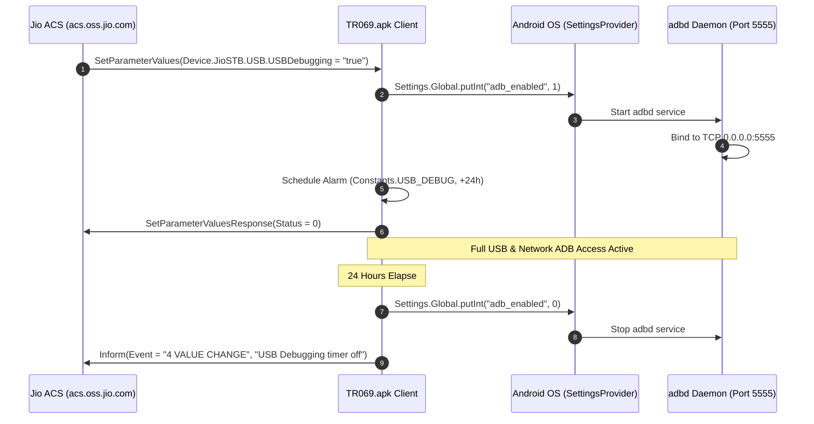

# Jio 4K STB (JMSB200A) — Remote ADB & Diagnostics via TR-069 / CWMP

> **Document Classification:** Vulnerability Research & Firmware Deep Dive  
> **Target Package:** `com.jio.tr069client` (Version `4.2.3`, build `423`)  
> **Source Location:** [`ota_packages/extracted/apks/jio_system_priv_app/TR069.apk`](ota_packages/extracted/apks/jio_system_priv_app/TR069.apk)  
> **Target System:** Android TV 11 (API 30), Kernel 5.4 GKI v3, SoC Amlogic S905X4 (`sc2`)  
> **Related Documents:** [`TR069_ACS_RESEARCH.md`](TR069_ACS_RESEARCH.md), [`ROOT_ADB_CUSTOM_ROM_GUIDE.md`](ROOT_ADB_CUSTOM_ROM_GUIDE.md)

---

## 1. Executive Summary

Static reverse engineering and decompilation of the extracted firmware privileged application [`TR069.apk`](ota_packages/extracted/apks/jio_system_priv_app/TR069.apk) confirms that **Reliance Jio Set-Top Boxes possess native, built-in capabilities to remotely enable Android Debug Bridge (ADB) debugging via TR-069 (CWMP)**.

This functionality is intentionally built into the carrier management client for field diagnostics, automated testing, and technical support. Two distinct execution mechanisms exist within the firmware:

1. **Direct Dedicated Parameter (`Device.JioSTB.USB.USBDebugging`)**: A vendor extension parameter that directly toggles `Settings.Global.adb_enabled` via Android system APIs under system privileges, coupled with an automated 24-hour expiration alarm.
2. **Command Line Utility Subsystem (`Device.JioSTB.Debugging.Command.*`)**: A remote shell command execution interface that directly injects settings (`settings put global adb_enabled 1`) or executes native shell commands via `Runtime.getRuntime().exec()`.

Because the system property `service.adb.tcp.port=5555` is permanently pre-configured in `vendor/build.prop`, enabling ADB immediately binds the `adbd` daemon to **TCP port 5555 over Wi-Fi and Ethernet**, providing full remote network shell access in addition to physical USB debugging.

---

## 2. Architectural Prerequisites & Privileges

The TR-069 client runs as a privileged system application in `/system_ext/priv-app/TR069` or `/system/priv-app/TR069`.

### 2.1 Privileged Permissions

From [`TR069.apk`'s AndroidManifest.xml](ota_packages/extracted/apks/jio_system_priv_app/TR069.apk):

```xml
<manifest package="com.jio.tr069client" 
          android:versionCode="423" 
          android:versionName="4.2.3" 
          android:compileSdkVersion="34" 
          android:compileSdkVersionCodename="14">

    <!-- Critical permissions for toggling debugging without user confirmation -->
    <uses-permission android:name="android.permission.WRITE_SECURE_SETTINGS" />
    <uses-permission android:name="android.permission.WRITE_SETTINGS" />
    <uses-permission android:name="android.permission.MANAGE_DEVICE_POLICY_DEBUGGING_FEATURES" />
    <uses-permission android:name="android.permission.INTERACT_ACROSS_USERS" />
    <uses-permission android:name="android.permission.REBOOT" />
    <uses-permission android:name="android.permission.RECOVERY" />
</manifest>
```

- **`WRITE_SECURE_SETTINGS`**: Enables the process to alter `Settings.Global` without requiring root or the `android.permission-group.SYSTEM_TOOLS` prompt.
- **`MANAGE_DEVICE_POLICY_DEBUGGING_FEATURES`**: Introduced in modern Android versions to allow device owners and MDM agents to suppress or enable USB debugging policies.

### 2.2 Network Daemon Configuration (`vendor/build.prop`)

In standard AOSP, enabling USB debugging only enables the USB gadget function (`sys.usb.config=adb`). However, on the Jio 4K STB, the vendor partition pre-configures network ADB:

```ini
# From /vendor/build.prop
service.adb.tcp.port=5555
```

When `Settings.Global.adb_enabled` transitions from `0` to `1`, the Android init runtime starts `/apex/com.android.adbd/bin/adbd`. Because `service.adb.tcp.port` is defined, `adbd` automatically binds to `0.0.0.0:5555`. No physical USB cable is required; network connections over the local LAN succeed immediately:
```bash
adb connect <STB_IP_ADDRESS>:5555
```

---

## 3. Mechanism 1: Dedicated Vendor Parameter (`Device.JioSTB.USB.USBDebugging`)

### 3.1 Data Model Registration

In [`TRParameterListCommon.java`](file:///tmp/tr069_jadx/sources/com/jio/tr069client/data/TRParameterListCommon.java#L321-L322), the TR-069 parameter tree registers the USB debugging parameters:

```java
// TRParameterListCommon.java (lines 321-322)
ParameterEntity parameterEntityParam$default249 = UtilityFileKt.param$default(
    objectConstants.getUsb() + ".DebugValidityDate", 
    null, null, null, null, paramtype2, null, 94, null
);

ParameterEntity parameterEntityParam$default250 = UtilityFileKt.param$default(
    objectConstants.getUsb() + ".USBDebugging", 
    "false", 
    notificationtype3, 
    writableVar, 
    datatypeVar5, 
    null, null, 96, null
);
```

- **`objectConstants.getUsb()`**: Resolves to `"Device.JioSTB.USB"`.
- **`writableVar`**: Configured as writable (`Access = "1" / Write`), meaning the ACS can update it via CWMP `SetParameterValues`.
- **Default value**: `"false"`.

### 3.2 Handler Implementation (`SetParamData.java`)

When the CPE processes a `SetParameterValues` RPC containing `Device.JioSTB.USB.USBDebugging`, execution dispatches to [`setUSBEnableDisabled()`](file:///tmp/tr069_jadx/sources/com/jio/tr069client/parser/factory/rpcmethod/SetParamData.java#L1405-L1457):

```java
// SetParamData.java (lines 1405-1457)
public final void setUSBEnableDisabled(@NotNull String name, @NotNull String value, @NotNull DeviceEquipmentManager deviceEquipmentManager) {
    Intrinsics.checkNotNullParameter(name, "name");
    Intrinsics.checkNotNullParameter(value, "value");
    Intrinsics.checkNotNullParameter(deviceEquipmentManager, "deviceEquipmentManager");

    if (!StringsKt.b(name, Constants.DEVICE_USB_USBDEBUGGING)) {
        if (StringsKt.b(name, Constants.DEVICE_USB_DEBUGVALIDITYDATE)) {
            ParameterEntity paramValue = deviceEquipmentManager.getDbRepository()
                .getMParameterRepository().getParamValue(Constants.DEVICE_USB_USBDEBUGGING);
            if (paramValue != null && DeviceUtil.INSTANCE.isValueTrue(paramValue.getValue())) {
                deviceEquipmentManager.getMAlarmScheduler().startAlarm(Constants.USB_DEBUG, value);
                deviceEquipmentManager.getMAlarmRepository().addOrUpdate(Constants.USB_DEBUG, value, Constants.DEVICE_USB_USBDEBUGGING);
                return;
            } else {
                ParameterRepository mParameterRepository = deviceEquipmentManager.getDbRepository().getMParameterRepository();
                String ISO8601_DEFAULT_DATE_TIME = Constants.ISO8601_DEFAULT_DATE_TIME;
                mParameterRepository.updateValueByPath(Constants.DEVICE_USB_DEBUGVALIDITYDATE, ISO8601_DEFAULT_DATE_TIME);
                return;
            }
        }
        return;
    }

    DeviceUtil deviceUtil = DeviceUtil.INSTANCE;
    boolean zIsValueTrue = deviceUtil.isValueTrue(value);
    
    // Broadcast notification to Data Collector (DC)
    DCParameterNotify mDCParameterNotify = deviceEquipmentManager.getMDCParameterNotify();
    if (mDCParameterNotify != null) {
        mDCParameterNotify.DCCallBackParameterValue(DCConstent.INSTANCE.getDC_USB_DEBUG_VALUE_CHANGED_EVENT(), Boolean.valueOf(zIsValueTrue));
    }

    // --- TURN USB / NETWORK DEBUGGING OFF ---
    if (deviceUtil.isValueFalse(value)) {
        Settings.Global.putInt(deviceEquipmentManager.getApplication().getContentResolver(), "adb_enabled", 0);
        Log.d("TR069-JioService", "usb dubugging off");
        AlarmScheduler.INSTANCE.closeAlarmSchedular(Constants.USB_DEBUG);
        deviceEquipmentManager.getMAlarmRepository().removeAlarmFromDB(Constants.USB_DEBUG);
        String ISO8601_DEFAULT_DATE_TIME2 = Constants.ISO8601_DEFAULT_DATE_TIME;
        DeviceEquipmentManager.sendInFourValueChangeIfParameterChanged$default(
            deviceEquipmentManager, Constants.DEVICE_USB_DEBUGVALIDITYDATE, ISO8601_DEFAULT_DATE_TIME2, "xsd:dateTime", false, 8, null
        );
        deviceEquipmentManager.startSession("usb debugging 0");
        return;
    }

    // --- TURN USB / NETWORK DEBUGGING ON ---
    Settings.Global.putInt(deviceEquipmentManager.getApplication().getContentResolver(), "adb_enabled", 1);
    Log.d("TR069-JioService", "usb dubugging ON");

    // Check if ACS provided an explicit expiration timestamp
    ParameterEntity paramValue2 = deviceEquipmentManager.getDbRepository()
        .getMParameterRepository().getParamValue(Constants.DEVICE_USB_DEBUGVALIDITYDATE);
    String value2 = paramValue2 != null ? paramValue2.getValue() : null;

    if (value2 != null && !Intrinsics.areEqual(value2, "") && !Intrinsics.areEqual(value2, Constants.ISO8601_DEFAULT_DATE_TIME)) {
        deviceEquipmentManager.getMAlarmScheduler().startAlarm(Constants.USB_DEBUG, value2);
        deviceEquipmentManager.getMAlarmRepository().addOrUpdate(Constants.USB_DEBUG, value2, Constants.DEVICE_USB_USBDEBUGGING);
        return;
    }

    // Default Fallback: Automatically schedule auto-disabling in 24 hours
    String next24HrISOCurrentDateTime = Utility.INSTANCE.getNext24HrISOCurrentDateTime();
    deviceEquipmentManager.getMAlarmScheduler().startAlarm(Constants.USB_DEBUG, next24HrISOCurrentDateTime);
    deviceEquipmentManager.getMAlarmRepository().addOrUpdate(Constants.USB_DEBUG, next24HrISOCurrentDateTime, Constants.DEVICE_USB_USBDEBUGGING);
    DeviceEquipmentManager.sendInFourValueChangeIfParameterChanged$default(
        deviceEquipmentManager, Constants.DEVICE_USB_DEBUGVALIDITYDATE, next24HrISOCurrentDateTime, "xsd:dateTime", false, 8, null
    );
    deviceEquipmentManager.startSession("usb debugging default date set ");
}
```

### 3.3 Automated Expiration & Alarm Trigger (`AlarmTrigger.java`)

To prevent devices from remaining permanently debuggable on subscriber networks, the client uses an alarm system:

```java
// AlarmTrigger.java (lines 379-401)
private final void resetUSBObject(int type) {
    // Reverts setting back to 0
    Settings.Global.putInt(getApplication().getContentResolver(), "adb_enabled", 0);
    
    DCParameterNotify mDCParameterNotify = getMDeviceEquipmentManager().getMDCParameterNotify();
    if (mDCParameterNotify != null) {
        mDCParameterNotify.DCCallBackParameterValue(DCConstent.INSTANCE.getDC_USB_DEBUG_VALUE_CHANGED_EVENT(), Boolean.FALSE);
    }
    Log.d("TR069-JioService", "usb debugging off timer");
    
    // Sends CWMP Inform session to notify ACS that debug access expired
    NotifiyACS("USB Debugging timer off", new Pair<>(Constants.DEVICE_USB_USBDEBUGGING, Constants.DEVICE_USB_DEBUGVALIDITYDATE));
    closeAlarm(type);
}

public final void NotifiyACS(@NotNull String msg, @NotNull Pair<String, String> params) {
    String strComponent1 = params.component1();
    String strComponent2 = params.component2();
    DeviceEquipmentManager.sendInFourValueChangeIfParameterChanged$default(getMDeviceEquipmentManager(), strComponent1, "0", "", false, 8, null);
    DeviceEquipmentManager.sendInFourValueChangeIfParameterChanged$default(getMDeviceEquipmentManager(), strComponent2, Constants.ISO8601_DEFAULT_DATE_TIME, "", false, 8, null);
    getMDeviceEquipmentManager().startSession(msg);
}
```



---

## 4. Mechanism 2: Remote Command Line Utility (`Device.JioSTB.Debugging.Command.*`)

In addition to the explicit USB parameter, the TR-069 client provides a full remote shell and configuration injection mechanism referred to in the codebase as the **Command Line Utility (CLU)**.

### 4.1 Data Model Node Definition

Defined in [`Constants.java`](file:///tmp/tr069_jadx/sources/com/jio/tr069client/common/Constants.java#L144-L152):

| Parameter | Type | Access | Description |
| :--- | :--- | :--- | :--- |
| `Device.JioSTB.Debugging.Command.Enable` | `boolean` / `unsignedInt` | R/W | Activates command processing (`"1"` or `"true"`) |
| `Device.JioSTB.Debugging.Command.Input` | `string` | R/W | Shell command(s) or settings commands |
| `Device.JioSTB.Debugging.Command.Output` | `string` | R | Standard output & standard error of execution |
| `Device.JioSTB.Debugging.Command.SaveToFile` | `unsignedInt` | R/W | If `1`, writes command results to persistent storage |
| `Device.JioSTB.Debugging.Command.ValidityDate` | `xsd:dateTime` | R/W | Expiration timestamp for the CLU session |
| `Device.JioSTB.Debugging.Command.Rerun` | `unsignedInt` | R/W | Re-executes the command on trigger |
| `Device.JioSTB.Debugging.Command.Frequency` | `unsignedInt` | R/W | Recurring execution frequency in seconds |
| `Device.JioSTB.Debugging.Command.Error` | `string` | R | Error string (e.g. `"Only 5 commands accepted"`) |

### 4.2 Command Parsing and Execution Logic

Command execution is orchestrated by [`CommandUtilityManager.java`](file:///tmp/tr069_jadx/sources/com/jio/tr069client/commandUtility/CommandUtilityManager.java#L349-L381) and implemented in [`CommandUtility.java`](file:///tmp/tr069_jadx/sources/com/jio/tr069client/commandUtility/CommandUtility.java#L125-L187):

#### A. Direct Setting Command Interception
If the input command starts with `settings put`, `CommandUtility` parses the arguments and writes them directly into the Android system provider:

```java
// CommandUtility.java (lines 156-184)
List listW = StringsKt.w(new Regex("\\s+").replace(strCmd, " "), new String[]{" "});
if (!listW.isEmpty() && listW.size() == 5 
    && StringsKt.equals((String) listW.get(0), "settings", true) 
    && StringsKt.equals((String) listW.get(1), "put", true)) {

    ContentResolver contentResolver = LibraryApplication.INSTANCE.getInstance().getContentResolver();
    String namespace = (String) listW.get(2); // "global", "secure", or "system"
    String key = (String) listW.get(3);       // e.g. "adb_enabled"
    String value = (String) listW.get(4);     // e.g. "1"

    if (StringsKt.equals(namespace, "global", true)) {
        if (StringExtentionsKt.isDigit(value)) {
            Settings.Global.putInt(contentResolver, key, Integer.parseInt(value));
        } else {
            Settings.Global.putString(contentResolver, key, value);
        }
    } else if (StringsKt.equals(namespace, "secure", true)) {
        Settings.Secure.putString(contentResolver, key, value);
    }
}
```

An ACS payload of:
```
settings put global adb_enabled 1
```
immediately turns on ADB debugging.

#### B. Native Shell Execution (`Runtime.getRuntime().exec()`)
If the command is not a `settings put` string, it falls back to native shell execution:

```java
// CommandUtility.java (lines 127-154)
Process processExec2 = Runtime.getRuntime().exec(strReplace$default);
processExec2.waitFor();
bufferedReader = new BufferedReader(new InputStreamReader(processExec2.getInputStream()));
bufferedReader2 = new BufferedReader(new InputStreamReader(processExec2.getErrorStream()));
// Reads stdout & stderr into StringBuilder sb
```

Chained commands (up to 5 separated by `;`) are supported:
```sh
setprop service.adb.tcp.port 5555 ; start adbd
```
The output from standard out and standard error is buffered and stored in `Device.JioSTB.Debugging.Command.Output`, which the STB reports back to the ACS via a CWMP Inform.

---

## 5. CWMP Protocol Payloads (SOAP Envelopes)

### 5.1 ACS Request to Enable ADB (`SetParameterValues`)

The ACS issues an HTTP POST to the STB containing the following SOAP envelope:

```xml
<soap:Envelope xmlns:soap="http://schemas.xmlsoap.org/soap/envelope/"
               xmlns:cwmp="urn:dslforum-org:cwmp-1-2"
               xmlns:xsd="http://www.w3.org/2001/XMLSchema"
               xmlns:xsi="http://www.w3.org/2001/XMLSchema-instance">
  <soap:Header>
    <cwmp:ID mustUnderstand="1">JIO_ADB_ENABLE_1001</cwmp:ID>
  </soap:Header>
  <soap:Body>
    <cwmp:SetParameterValues>
      <ParameterList soap:arrayType="cwmp:ParameterValueStruct[2]">
        <ParameterValueStruct>
          <Name>Device.JioSTB.USB.USBDebugging</Name>
          <Value xsi:type="xsd:boolean">true</Value>
        </ParameterValueStruct>
        <ParameterValueStruct>
          <Name>Device.JioSTB.USB.DebugValidityDate</Name>
          <Value xsi:type="xsd:dateTime">2026-10-31T23:59:59Z</Value>
        </ParameterValueStruct>
      </ParameterList>
      <ParameterKey>JIO_DIAG_TOKEN</ParameterKey>
    </cwmp:SetParameterValues>
  </soap:Body>
</soap:Envelope>
```

### 5.2 CPE Success Response (`SetParameterValuesResponse`)

The STB executes the settings update and acknowledges:

```xml
<soap:Envelope xmlns:soap="http://schemas.xmlsoap.org/soap/envelope/"
               xmlns:cwmp="urn:dslforum-org:cwmp-1-2">
  <soap:Header>
    <cwmp:ID mustUnderstand="1">JIO_ADB_ENABLE_1001</cwmp:ID>
  </soap:Header>
  <soap:Body>
    <cwmp:SetParameterValuesResponse>
      <Status>0</Status>
    </cwmp:SetParameterValuesResponse>
  </soap:Body>
</soap:Envelope>
```
*(Status `0` indicates parameters were validated and applied synchronously).*

---

## 6. Cryptographic Trust & Local Interception Analysis

### 6.1 Server Resolution & Endpoints

From [`Config.java`](file:///tmp/tr069_jadx/sources/com/jio/tr069client/common/Config.java#L37-L73):
1. **Dynamic Config File**: The client first checks for the existence of:
   ```
   /data/data/com.jio.tr069client/config.config
   ```
2. **Asset Fallback**: If the file does not exist, it extracts `assets/stb_config.config`:
   ```properties
   # stb_config.config
   acsurl=https://acs.oss.jio.com:8443/ftacs-digest/ACS
   ```
3. **Hardcoded Fallback**:
   - STB default: `https://acs.oss.jio.com:8443/ftacs-digest/ACS`
   - JioBook / OVT default: `https://macs.oss.jio.com:8443/ftacs-digest/ACS`

### 6.2 Embedded TLS Certificates & Trust Store

The client connects over mutual TLS / enterprise HTTPS using certificates packaged in `assets/`:

| Certificate File | Format | Role |
| :--- | :--- | :--- |
| `assets/acs_oss_jio_com.cer` | X.509 DER | Production ACS server cert / pinning anchor |
| `assets/prod/jio_internal_server_sub_ca_chain.pem` | PEM Chain | Reliance Subordinate CA (`RILSUBCA01`) |
| `assets/prod/v4_key.pem` | RSA 2048 Private Key | Client private key for IPv4 connections |
| `assets/prod/v6_key.pem` | RSA 2048 Private Key | Client private key for IPv6 connections |
| `assets/prod/jio_device_heartbeat_v4_jio_com_crt.pem` | PEM | Client identity certificate |
| `assets/rootca.crt` | X.509 PEM | Reliance Root CA |

### 6.3 TLS Bypass Findings in Subsystems

While the primary CWMP engine uses the internal Sub-CA chain, several secondary subsystems within `TR069.apk` contain permissive dummy trust managers:
- [`DownloadTask.java`](file:///tmp/tr069_jadx/sources/com/jio/tr069client/filetransfer/downlod/DownloadTask.java#L84): Contains `trustAllCerts = new X509TrustManager() { ... }` that completely suppresses TLS certificate verification for file downloads.
- [`ApiClient.java`](file:///tmp/tr069_jadx/sources/com/jio/tr069client/ont/ApiClient.java#L58): Contains `trustAllCerts` overriding the OkHttpClient builder.
- [`NetworkingKt.java`](file:///tmp/tr069_jadx/sources/com/jio/tr069client/download/networking/NetworkingKt.java#L36): Contains dummy X509TrustManager.

---

## 7. Comparative Assessment: ADB Enablement Vectors

| Method | Access Level Required | Remote Feasible? | Stability / Limitations |
| :--- | :--- | :--- | :--- |
| **TR-069 `Device.JioSTB.USB.USBDebugging`** | Carrier ACS | **Yes (WAN)** | Times out automatically after 24 hours. |
| **TR-069 `Device.JioSTB.Debugging.Command`** | Carrier ACS | **Yes (WAN)** | Limited to 5 chained commands; can be blocked by CLU policy. |
| **Remote 10x OK Click Combo** | Physical IR/BT Remote | No (Local UI) | Fails on recent builds sending keycode 66 instead of 23. |
| **Hardware UART (`J7`)** | Physical Disassembly | No (Local HW) | Production `user` build disables terminal RX shell (`ro.debuggable=0`). |
| **Hardware MaskROM Mode** | Physical Short / Reset button | No (Local HW) | Requires Amlogic USB Burning Tool / custom signed FIP. |

---

## 8. Conclusion

The analysis conclusively proves that **TR-069 on the Jio 4K STB has full remote capability to activate ADB debugging on demand**. 

Reliance Jio engineers use this channel to diagnose and debug devices in the field. For security researchers working on authorized lab devices:
1. Intercepting or emulating this mechanism locally requires either extracting the `RILSUBCA01` subordinate certificate to terminate the STB's TLS session or rewriting `acsurl` in `/data/data/com.jio.tr069client/config.config`.
2. When ADB is toggled by this parameter, no user confirmation prompt is shown on the TV display, and network ADB immediately listens on `5555/tcp` due to the static property in `/vendor/build.prop`.
---
## 🔗 Related Documents

| Related Document | Relationship |
| :--- | :--- |
| [`TR069_ACS_RESEARCH.md`](TR069_ACS_RESEARCH.md) | ACS protocol mechanics, CWMP data model (TR-181/TR-135), security posture, and attack classes. |
| [`ROOT_ADB_CUSTOM_ROM_GUIDE.md`](ROOT_ADB_CUSTOM_ROM_GUIDE.md) | ADB enablement methods and the prerequisite that `service.adb.tcp.port=5555` is hardcoded in `vendor/build.prop`. |
| [`JDWP_SYSTEM_ESCALATION_FINDINGS.md`](JDWP_SYSTEM_ESCALATION_FINDINGS.md) | Follow-on system-UID (UID 1000) JDWP escalation once network ADB is enabled via TR-069. |
| [`jio_infrastructure/02_DEVICE_MANAGEMENT_TR069_ACS.md`](jio_infrastructure/02_DEVICE_MANAGEMENT_TR069_ACS.md) | §5.1 — Remote ADB activation parameter `Device.JioSTB.USB.USBDebugging` and §5.2 arbitrary command execution subsystem. |
