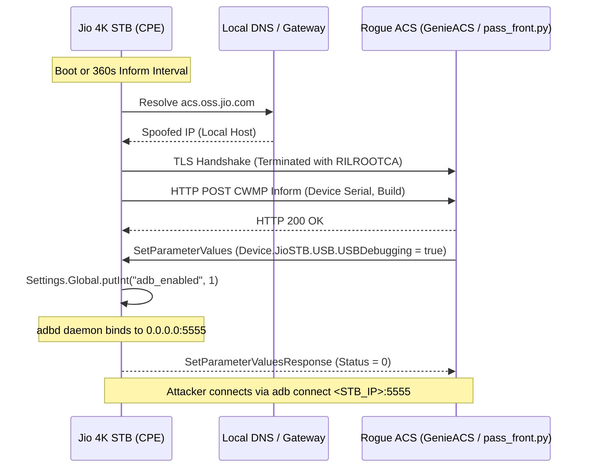

# 11. Security Audit, Attack Surface & Research Roadmap

> **Parent Topic:** [`jio_infrastructure/README.md`](README.md)  
> **Classification:** Defensive Security Assessment & Architectural Vulnerability Audit  
> **Related Research:** [`TR069_ACS_RESEARCH.md`](../TR069_ACS_RESEARCH.md), [`TR069_REMOTE_ADB_ANALYSIS.md`](../TR069_REMOTE_ADB_ANALYSIS.md), [`FIRMWARE_ENDPOINTS_AND_EXPOSURES.md`](../FIRMWARE_ENDPOINTS_AND_EXPOSURES.md), [`Housekeeping-SDK.md`](../Housekeeping-PoC/Housekeeping-SDK.md)

---

## 1. Executive Summary

This document synthesizes the overarching security posture, architectural vulnerabilities, and trust-boundary exposures identified across Reliance Jio's device management, firmware delivery, and on-device application tiers.

The findings demonstrate that while carrier management channels enforce private enterprise PKI, multiple critical architectural assumptions undermine device boundary isolation:
1. **Hardcoded Mutual-TLS Cryptographic Keys:** Private RSA keys granting access to the production Device Heartbeat cloud are embedded in public APK assets.
2. **Cleartext Transport Channels:** Firmware images, update packages, internal PHP API proxies, and test analytics are routed over plaintext HTTP.
3. **Built-in Remote Command & Debugging Execution:** The TR-069 CWMP client possesses native parameters to toggle network ADB and execute arbitrary shell strings under system privileges.
4. **Unsanitized Native Root Daemons:** Init-started native daemons (`sdknativeservice`) running under `uid 0` expose unauthenticated binder interfaces with direct shell command injection flaws.

---

## 2. Attack Surface Breakdown by Architectural Tier

### 2.1 Transport Layer & Plaintext Vulnerabilities
Despite ubiquitous HTTPS adoption across consumer web properties, large portions of Jio’s backend communications operate over cleartext HTTP:

| Exposed Endpoint | Transport | Risk Category | Architectural Impact |
| :--- | :--- | :--- | :--- |
| `fota.slv.kai.jiophone.net`<br>`fota.slv.fxd.jiophone.net` | Cleartext HTTP (TCP 80) | Firmware Tampering & Cache Poisoning | Firmware updates depend entirely on OEM RSA signature checks in recovery rather than transport security. In-path actors can inspect exact download URLs, package sizes, and build tokens. |
| `49.40.64.244:6080` | Cleartext HTTP (TCP 6080) | Man-in-the-Middle (MITM) & Credential Interception | Direct PHP proxy APIs (`proxy.api.php`, `proxy.vapi.php`, `sit.api.php`) transmit app store queries and voice requests without encryption across AS55836. |
| `49.40.64.194:8124` | Cleartext HTTP (TCP 8124) | Unencrypted Speech Output Engine & Biometric Routing Flaw | Direct internal datacenter node serving `/soe/api/tts/v1` and `/soe/activity/srsdeletepid` without TLS. A conditional logic bug (`c != 1`) causes production STBs worldwide to send voice biometric deletion requests with subscriber SSO tokens over unencrypted HTTP. |
| `jiova.akamaized.net` (`/static/config/va-stb-config.json`) | Cleartext HTTP (TCP 80) | Dynamic Configuration Tampering & Security Bypass | Dynamic voice configuration is fetched over unencrypted HTTP from AkamaiNetStorage. Remote parameters explicitly set `ssl_connect: {is_enabled: false}`, hardcode diagnostic backdoor PINs (`password: 777333`), and control Bluetooth RCU MAC whitelisting. |
| `sit-devents.magnum.jio.com` | Cleartext HTTP (TCP 80) | Telemetry Spoofing & Eavesdropping | Unencrypted analytics ingestion permits eavesdropping on device identifiers, MAC addresses, and subscriber usage habits. |
| `iotacs.jioconnect.com:8080`<br>`iotacs.jioconnect.com:8001` | Cleartext HTTP (TCP 8080/8001) | Management Interception & Firmware Exposure | Residential ONT CWMP sessions and firmware images (`Arcadyan-OTA-...zip`) traverse cleartext channels. |

---

### 2.2 Cryptographic Key Exposure & PKI Compromise
Inspection of `TR069.apk` assets revealed bundled private keys that compromise the integrity of the dual-stack Device Heartbeat infrastructure:

```
Extracted Cryptographic Bundle:
├── assets/prod/jio_internal_server_sub_ca_chain.pem  (Subordinate CA Chain)
├── assets/prod/jio_device_heartbeat_v4_jio_com_crt.pem (Client Certificate)
├── assets/prod/v4_key.pem                            (RSA 2048-bit Private Key)
├── assets/prod/v6_key.pem                            (RSA 2048-bit Private Key)
├── assets/dev/dev_v4_key.pem                         (Dev RSA 2048-bit Private Key)
└── assets/dev/dev_v6_key.pem                         (Dev RSA 2048-bit Private Key)
```

#### Implications:
- Any researcher or adversary in possession of the client certificate and private key can establish authenticated mTLS connections to `https://jiodeviceheartbeat-v4.jio.com/` and `https://jiodeviceheartbeat-v6.jio.com/`.
- Enables automated spoofing of large-scale fleet telemetry, falsification of NAT states, and injection of fraudulent device presence data.

---

### 2.3 Hardcoded Carrier SFTP Telematics & System Logcat Exfiltration
Reverse engineering of [`ReportsViewModel.java`](file:///home/skylap/.gemini/antigravity-cli/brain/9b091e3d-1812-4d7a-95b7-f7edf5fd5292/scratch/jadx_voice/sources/com/android/app/jio/voiceassist/settings/report/viewmodel/ReportsViewModel.java), [`UploadLogFile.java`](file:///home/skylap/.gemini/antigravity-cli/brain/9b091e3d-1812-4d7a-95b7-f7edf5fd5292/scratch/jadx_voice/sources/com/android/app/jio/voiceassist/settings/report/repo/UploadLogFile.java), [`search/a/b.java`](file:///home/skylap/.gemini/antigravity-cli/brain/9b091e3d-1812-4d7a-95b7-f7edf5fd5292/scratch/jadx_voice/sources/com/android/app/jio/voiceassist/search/a/b.java), and [`search/a/c.java`](file:///home/skylap/.gemini/antigravity-cli/brain/9b091e3d-1812-4d7a-95b7-f7edf5fd5292/scratch/jadx_voice/sources/com/android/app/jio/voiceassist/search/a/c.java) in `JioVoice.apk` uncovered **hardcoded plaintext carrier SFTP credentials** combined with unrestricted system log collection:
* **Server:** `sftp.telematics.jio.com` (Port 22 / SFTP)
* **Username:** `va` (100% static across all fleet devices; obfuscated as `aW4=`)
* **Password:** `V@13ji@o` (100% static across all fleet devices; obfuscated as `SUAxM3d2QGI=`)
* **Target Directory:** `Logging/STB` (Obfuscated as `WWJ0dHZhdC9GR08=`)
* **Host Verification:** Explicitly bypassed via `properties.put("StrictHostKeyChecking", "no");` in both JSch uploaders.
* **Exfiltration Pipelines:**
  1. **Predefined Reports (Codes 1001–1005):** Executes `logcat -d`, writes `/cache/STB_<SERIAL>_<CODE>.txt`, wipes on-device log buffer via `logcat -c`, and SFTPs to carrier cloud.
  2. **Custom Feedback (Code 1006):** User-typed feedback in `MyReasonReportScreen` is silently discarded; the UI event triggers a 3-minute streaming `logcat -b main` process capture buffered in memory and exfiltrated over SFTP.
* **Sensitive Data Exposed in Dump:** Hardware serial (`ro.serialno`), Wi-Fi BSSID/SSID, FTTH subscriber ID, active OAuth/JWT tokens, live TV channel tuning intents, full voice transcripts (`SPEECH_FINAL_OUTPUT`), and uncaught system exceptions.
* **Comprehensive Audit:** For full bytecode analysis, deobfuscation traces, and data inventories, see [`jio_infrastructure/08_VOICE_AI_AND_HELLOMODELS.md#7-security-deep-dive-hardcoded-telematics-sftp--system-logcat-exfiltration`](08_VOICE_AI_AND_HELLOMODELS.md#7-security-deep-dive-hardcoded-telematics-sftp--system-logcat-exfiltration).

---

### 2.4 Remote CWMP Management & Rogue ACS Hijacking
The TR-069 management layer provides the most powerful attack surface:



#### Documented Vulnerabilities:
1. **Unconditional Setting Override:** Setting `Device.JioSTB.USB.USBDebugging = true` immediately enables USB and network debugging without prompting the television screen for user consent.
2. **Permanent TCP Socket Pre-Configuration:** `vendor/build.prop` contains `service.adb.tcp.port=5555`, meaning ADB immediately opens over Wi-Fi/Ethernet without requiring physical USB access.
3. **Arbitrary Shell Execution:** The parameter tree `Device.JioSTB.Debugging.Command.*` accepts shell strings executed via `Runtime.getRuntime().exec()`.

---

### 2.4 Local Subnet & Native Daemon Exposure
When an attacker or researcher is positioned on the same local subnet as the STB:

1. **Local NanoHTTPD Flashing Portal (`54321/TCP`):**
   - Implemented in `JioHttpUpdate.apk`.
   - The 8-digit OTP challenge is displayed on the screen, but can be brute-forced or intercepted if an attacker can read system properties or screenshot the display via ADB.
2. **Local Root Escalation (`sdknativeservice`):**
   - The daemon `/system/bin/sdknativeservice` runs under `uid 0` and registers binder service `com.jio.sdk.sdknativeservice`.
   - Lacks `getCallingUid()` permission checks.
   - The OS module's `get-cpu-temperature` command passes arbitrary strings directly to `popen()`, granting instant root privileges (`uid=0 gid=0 context=u:r:sdknativeservice:s0`) from a standard ADB shell.

### 2.5 Fail-Open Whitelist Exception Bypass in Master SSO Broker (`JioStbSsoService.apk`)
Inspection of the central identity broker [`JioStbSsoService.apk`](../ota_packages/extracted/apks/jio_system_priv_app/JioStbSsoService.apk) (`com.media.jio.sso.stb`) revealed a critical access control vulnerability:
* **Target Interface:** Exported AIDL service `com.media.jio.sso.stb.services.AIDLServer` listening for intent action `service.sso` **without any Android permissions**.
* **Vulnerable Logic ([`MediaLoginActivity.java:3806-3826`](file:///home/skylap/.gemini/antigravity-cli/brain/9b091e3d-1812-4d7a-95b7-f7edf5fd5292/scratch/jadx_sso/sources/com/media/jio/sso/stb/activity/MediaLoginActivity.java#L3806-L3826)):**
  When a calling application calls `getLoginData()`, `MediaLoginActivity` issues a network request to `/apis/v2.0/service/get` to verify if the caller package is whitelisted.
  ```java
  com.media.jio.sso.stb.network.a.C0065a c0065aT = aVar2.T(str, strO, rVar2.q());
  if (c0065aT.c()) { // c() returns true on network or parsing exception
      r(c0065aT);
      return o(str, jVarF); // FAILS OPEN: Returns master subscriber tokens!
  }
  ```
* **Security & Privacy Impact:** If the verification call encounters a network timeout, DNS resolution failure, or is executed while the STB is offline, the authorization logic **fails open**. Any unprivileged, non-whitelisted third-party APK can bind to `service.sso` and exfiltrate the subscriber's master JWT bearer token (`ssoToken`), session token (`jToken`), registered mobile number, and FTTH circuit ID.

---

### 2.6 Privileged Activity Launch Trampoline (`JioCommandReceiver.apk`)
Static analysis of [`JioCommandReceiver.apk`](../ota_packages/extracted/apks/jio_system_priv_app/JioCommandReceiver.apk) (`com.rjil.jio.stb.commandreceiver`) revealed a severe intent redirection vulnerability:
* **Execution Context:** Runs under **`android.uid.system`** (System UID).
* **Build Profile:** Shipped to production with **`android:debuggable="true"`** enabled.
* **Vulnerable Logic ([`JioCommandReceiver.java:18-35`](file:///home/skylap/.gemini/antigravity-cli/brain/9b091e3d-1812-4d7a-95b7-f7edf5fd5292/scratch/jadx_cmd/sources/com/rjil/jio/stb/commandreceiver/JioCommandReceiver.java#L18-L35)):**
  ```java
  public class JioCommandReceiver extends BroadcastReceiver {
      @Override
      public void onReceive(Context context, Intent intent) {
          if (intent.getAction().equalsIgnoreCase("com.jio.myhome.mediasharedmp.intent.action.ACTIVITY_LAUNCH")) {
              String packageName = intent.getStringExtra("packageName");
              String className = intent.getStringExtra("className");
              String data = intent.getStringExtra("dataString");
              
              Intent startActivityIntent = new Intent();
              startActivityIntent.setComponent(new ComponentName(packageName, className));
              startActivityIntent.putExtra("dataString", data);
              startActivityIntent.setFlags(Intent.FLAG_ACTIVITY_NEW_TASK);
              context.startActivity(startActivityIntent);
          }
      }
  }
  ```
* **Security Impact:** The broadcast receiver is exported with **no permission requirements**. Any unprivileged third-party app or local ADB user can broadcast `com.jio.myhome.mediasharedmp.intent.action.ACTIVITY_LAUNCH` with arbitrary `packageName` and `className`. Because the `startActivity()` call originates from a system process holding `android.uid.system`, it functions as a **privileged trampoline to bypass `android:exported="false"`** on protected, unexported system activities across the operating system (e.g., hidden engineering menus, factory reset activities, and restricted settings).

---

### 2.7 Insecure Local Gateway Transport & Trust-All X.509 Manager (`https://192.168.29.1/`)
In [`TR069.apk`](../ota_packages/extracted/apks/jio_system_priv_app/TR069.apk), the module responsible for querying the local JioFiber Gateway ([`ApiClient.java:50-95`](file:///home/skylap/.gemini/antigravity-cli/brain/9b091e3d-1812-4d7a-95b7-f7edf5fd5292/scratch/jadx_tr069/sources/com/jio/tr069client/ont/ApiClient.java#L50-L95)) explicitly bypasses standard TLS verification:
* **Target Address:** `https://192.168.29.1/` (Local ONT REST API)
* **Bypassed Hostname Verification:**
  ```java
  builder.hostnameVerifier((hostname, session) -> true);
  ```
* **Trust-All Certificates:** Configured with a custom `X509TrustManager` whose `checkServerTrusted()` and `checkClientTrusted()` implementations are completely empty.
* **Security Impact:** Any rogue host or local machine on the subnet `192.168.29.0/24` can ARP-spoof `192.168.29.1` and intercept or forge all ONT management calls (`getSSID`, `getDeviceDetails`), spoofing the gateway identity reported to the TR-069 ACS.

---

## 3. Structured Research Roadmap for Further Exploration

To continue structured research into Reliance Jio's infrastructure without disrupting operational networks, the following defensive methodologies are recommended:

### Phase 1: Passive Traffic Auditing & Flow Classification
- Deploy an inline gateway (e.g., OpenWrt or Linux router) between the STB and the upstream WAN.
- Execute [`scripts/capture_stb_urls.sh`](../scripts/capture_stb_urls.sh) to monitor live unencrypted HTTP requests to `49.40.64.244:6080` and `fota.slv.kai.jiophone.net`.
- Map new dynamic tokens and build tags generated during periodic update checks.

### Phase 2: Isolated TR-069 Lab Environment (Local ACS)
- Utilize the setup documented in [`Housekeeping-PoC/stage1.sh`](../Housekeeping-PoC/stage1.sh) and [`Housekeeping-PoC/tls/`](../Housekeeping-PoC/tls/):
  1. Stand up an isolated Docker container running **GenieACS** and MongoDB.
  2. Run the TLS termination proxy (`pass_front.py`) with certificates chained to `RILROOTCA`.
  3. Override local DNS (`acs.oss.jio.com` → local Docker IP).
  4. Intercept CWMP `Inform` packets to inspect full TR-181 data models, vendor extensions, and parameter attributes reported by the device.

### Phase 3: Firmware & Partition Deconstruction
- Decompress partition images located in [`ota_packages/extracted/partitions/`](../ota_packages/extracted/partitions/) (`system.img`, `system_ext.img`, `product.img`, `vendor.img`, `odm.img`).
- Extract native shared libraries (`libirInfo.so`, DRM widevine modules, hardware codecs) to identify proprietary ioctl calls and kernel driver interfaces.
- Audit SELinux policy files (`/vendor/etc/selinux/`, `/system/etc/selinux/`) to map permitted inter-domain transitions.

### Phase 4: Telemetry & Ingestion Schema Analysis
- Construct local mock servers replicating `devents.magnum.jio.com` and `jiodeviceheartbeat-v4.jio.com`.
- Inspect JSON schemas submitted by `JioAdc.apk` and `AKA.apk` to document user data collection boundaries and privacy compliance.

---
## 🔗 Related Documents

| Related Document | Relationship |
| :--- | :--- |
| [`../TR069_ACS_RESEARCH.md`](../TR069_ACS_RESEARCH.md) | ACS protocol attack classes and TR-069 security posture (§6). |
| [`../TR069_REMOTE_ADB_ANALYSIS.md`](../TR069_REMOTE_ADB_ANALYSIS.md) | Remote ADB enablement via TR-069 `Device.JioSTB.USB.USBDebugging` (attack surface §2.4). |
| [`../JDWP_SYSTEM_ESCALATION_FINDINGS.md`](../JDWP_SYSTEM_ESCALATION_FINDINGS.md) | Debuggable `JioCommandReceiver` system-UID (UID 1000) JDWP escalation (attack surface §2.6). |
| [`../VOICE_DYNAMIC_CONFIG_RESEARCH.md`](../VOICE_DYNAMIC_CONFIG_RESEARCH.md) | Hardcoded diagnostic PIN `777333`, cleartext SOE TTS, and voice biometric routing flaw (§2.1 transport, §2.3 SFTP exfiltration cross-reference). |
| [`Housekeeping-PoC/README.md`](../Housekeeping-PoC/README.md) | Two-stage bootloader unlock exploit demonstrating AVB/bootloader bypass in practice. |
